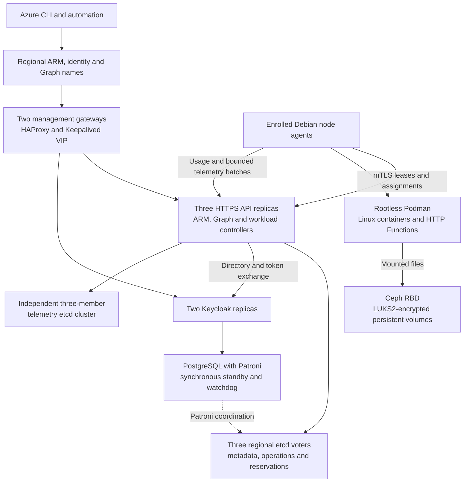
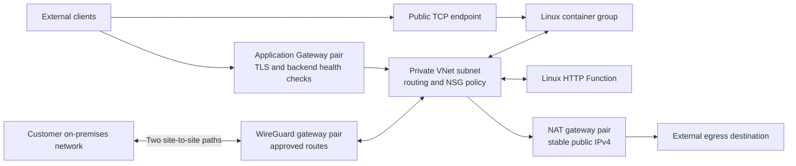

# ocean architecture

ocean is an open-source cloud platform on Debian. It uses Azure CLI as a
reference client for a defined compatibility contract. An ocean **region**, also
called a **farm**, has a regional management endpoint and multiple Debian
servers. A server can run more than one role. The phase-one topology starts
with one **cell** for workload placement and storage. Additional workers can
join the region while its three control-plane voters remain fixed.

Phase one passed all 34 required cases in the Debian KVM lab. Physical failure
domains, production capacity and recovery objectives, and multi-farm
continuity have their own acceptance gates. See the
[objective](objective.md) and [acceptance matrix](acceptance.tsv).

## Regional topology

The management gateways serve the regional DNS names and forward verified
HTTPS connections to healthy API replicas. In the lab, Keepalived moves a
management virtual IP between gateways. A client using a cached address can
keep the same destination after takeover. The three API replicas share durable
state through a two-of-three etcd quorum. A single API replica, gateway, or
voter can fail within the tested topology.

Keycloak handles OAuth and realm authentication. Ocean adapts discovery and
token exchange for Azure CLI. PostgreSQL holds the directory state and
requires a synchronous standby for commits in the tested profile. Patroni
coordinates promotion through the regional etcd cluster using its own state
prefix and certificate. The lab exercises watchdog fencing and verifies
that the former writer rejoins as a standby. See the
[regional lab setup](lab/README.md#regional-management-stack).

## Tenant and workload capabilities

| Area | Phase-one capabilities | Contract entry points |
| --- | --- | --- |
| Tenant onboarding and identity | Retry-safe onboarding of a tenant, initial administrator and subscription. Device-code sign-in for users and password-based service principals for automation. Create, update and delete directory users. Register applications, create service principals, and add or revoke password credentials. | Operator `az rest`, `az cloud`, `az login`, `az account`, selected `az ad user`, `az ad app` and `az ad sp`. |
| ARM and authorization | Subscription discovery, tagged resource groups, provider discovery, filtered and paginated inventory, resource lookup, and resource-group Reader assignments with server-side revocation. Durable polling and retries for asynchronous operations. | `az group`, `az provider show`, `az resource`, `az role assignment`. |
| Linux container groups | Run a single Linux container from a public, digest-pinned OCI image. Choose a public TCP endpoint or private subnet. Configure CPU and memory limits, restart policy, and ordinary or secure environment variables. Inspect, start, stop, restart, read logs and delete. | `az container`. |
| Persistent storage | Create a storage account and file share with the supported Azure Files contract. Mount the share in a container, retain its data across restarts, and recover it on an eligible host after confirming fencing. | `az storage account`, `az storage share-rm`, `az container create`. |
| Domain file shares | Use Kerberos to access private Samba member shares with native AD group grants and per-share storage limits. A locally redundant member pair shares one encrypted Samba identity and one private service address. The regional operation store authorizes a single writer generation and transfers it after signed power-off fencing. | `az ad group show`, `az rest` for `Ocean.Storage/smbShares`. |
| HTTP Functions | Deploy a Linux Functions v4 OCI image on a B1 plan. Discover functions, manage keys and settings, update the image, and control app lifecycle. Attach a private subnet and publish the function over HTTPS. Java 21 is the end-to-end deployment fixture. Node.js 22 exercises Insights, and .NET isolated and Go have runtime fixture checks. | `az functionapp`, selected networking commands. |
| Networking | Manage IPv4 VNets, subnets, NSGs and firewall rules. Expose private backends through a redundant Application Gateway. Assign Standard static public IPv4 addresses and a stable outbound address through NAT. Connect approved on-premises prefixes over two WireGuard paths. Preview and apply the supported network-only Bicep template. | Selected `az network` and `az deployment group`, plus `az rest` for `Ocean.Network/siteConnections`. |
| Usage, quotas and Insights | Read resource health, tenant audit events, container CPU and memory, current reservations and quota ceilings. Query supported request, error, latency, dependency and exception data, including reported telemetry gaps. | `az monitor metrics` and selected ARM and Insights endpoints through `az rest`. |
| Local placement and scaling | Run stateless private container replicas at a fixed count or scale locally on fresh CPU measurements. Reserve replacement capacity and keep serving through a worker failure on the local tier. | `az rest` for `Ocean.Compute/replicaSets`. |

The [Azure CLI 2.93.0 command matrix](tests/e2e/testdata/arm-contract.tsv)
defines supported flag combinations, resource types and API versions. The
[README](README.md#azure-cli-compatibility) shows how to register the cloud and
run supported workflows. The platform explicitly rejects unsupported
parameters and operations.

## Request, placement and execution

1. The API verifies token signature, issuer, audience and expiry. Current
   tenant, subscription and scope grants determine access on each request.
   Mutations and privileged denials generate tenant-scoped audit records.
2. A workload request selects an eligible cell, host and network endpoint.
   Applicable capacity, tenant quota, placement and operation state commit
   together. Retry identifiers and placement generations protect against
   duplicate reservations and stale cleanup. ARM polling exposes durable
   operation state through a controller restart.
3. A Debian node agent authenticates with its own mTLS certificate. The agent
   renews a capacity lease and reads only its authorized assignments. Pool,
   hardware, role, capacity and drain policy determine placement eligibility.
4. The worker applies the assigned network and storage policy and starts the
   workload with its configured runtime. The regional controllers reconcile
   the recorded intent with observed host and workload state.

The operator admits hosts through an approved inventory with management MAC,
address, cell, pool, profile and roles. A short-lived enrollment credential
and proof of possession bind each host certificate to its own key. In the
KVM lab, cloud-init installs the Debian agent package from a private NoCloud
seed at first boot. A lost response or restart preserves the enrolled identity.
Adding or draining eligible workers leaves voter membership under regional
operator control. See [host enrollment](lab/README.md#host-identity-enrollment)
and [capacity reservations](lab/README.md#leased-host-capacity-and-reservations).

### Optional tenant VMs

The VM profile admits prepared Debian and Windows Server 2025 Core images on
qualified Debian KVM workers. The subscription catalog binds the OS type to
the image and UEFI digests. Its ARM contract covers image registration,
private NIC allocation, VM and disk reads, VM start, graceful power-off and
deletion. A single transaction reserves CPU, RAM and the persistent OS disk
when the VM is created. The reservations stay charged while it is stopped.

The worker imports the digest-pinned disk and UEFI variables into encrypted
Ceph RBD and starts QEMU under an unprivileged runtime account. The private
TAP has a fixed MAC derived from the VM identity and a lease-bound network
policy. Regional placement transfers the writable disk generation only after
the original writer's lease expires and an authorized fencer confirms its
power-off. Recovery preserves the image, guest identity and private IP.
See the [KVM worker and acceptance guide](lab/README.md#debian-kvm-worker-service).

Personal desktop assignment records link one prepared Linux VM to a user or
security group in the tenant's managed Samba directory by object GUID. A
regional transaction records the binding and audit event and guards against
concurrent VM deletion or duplicate ownership. The VM's stable machine ID
binds the profile to the provisioned guest through power cycles. An assignment
ID stays stable on replay and changes with the principal.

The desktop authorization action takes an MFA-assured token from a dedicated
Keycloak application. The region resolves the federated subject to an AD object.
The Samba writer checks that the account is enabled, that it belongs to an
allowed application group and that it holds any group grant required by the
desktop assignment. The region checks the KVM worker lease and compares current state revisions
before returning a decision valid for at most 15 seconds. A successful decision
contains the assignment and machine IDs.

The launch action additionally requires a verified client certificate from an
allowlisted, enrolled gateway with a live host lease. The region checks the
VM's current NIC binding and ownership of its private address. It returns the
address, NIC and tenant subnet to the gateway. The issuance decision compares
the gateway enrollment and availability, assignment, directory, VM, NIC and
address allocation revisions in etcd. The audit event records the user
object ID and the desktop resource ID. Every regional API replica uses the
same signer and gateway allowlist, verified
against a public-key manifest in regional metadata.

The HTTPS desktop gateway runs the OIDC authorization code flow with PKCE,
state and nonce against the dedicated MFA client. It holds access and refresh
tokens in process memory and gives the browser an opaque secure session cookie.
Guacamole runs on the gateway's loopback interface and connects to private XRDP
using the guest certificate fingerprint. The browser sees display and input
events over an origin-checked WebSocket. Clipboard and drive redirection
are disabled. The gateway renews access every five seconds, or sooner near
expiry. It closes both connections on denial, a changed assignment or VM
generation, or expiry of the previous authorization.

The XRDP guest helper verifies a signed, single-use launch credential for the
guest's pinned machine ID and canonical AD sign-in name. The credential expires
within 15 seconds and the guest commits its receipt to a private persistent
directory before opening the session. PAM still applies the domain account and
session policies. Conventional private RDP logins keep the Debian password
authentication path.

Pool policy constrains initial placement and recovery. The enrolled agent
gets only the workload material required by its assignments. Regional key
material protects sealed environment variables and volume keys. Assigned
workers receive the material they need over mTLS. Approved operators are
part of the trust model for running workloads. Attestation-bound key release
and confidential execution are later design extensions for contributed hosts.

## Workload network paths

The container node applies tenant routing and firewall policy through Linux
network namespaces and nftables. Leased assignments bound stale forwarding.
The diagram shows alternative public and private paths for container groups.
Application Gateway terminates HTTPS and probes selected private backends.
WireGuard forwards approved customer prefixes through dedicated gateway roles.
A managed subnet can select a NAT gateway for fixed IPv4 egress. The lab uses
separate management, workload and customer network segments. Active private
workload prefixes on the shared regional fabric must be exclusive. See the
[networking lab guide](lab/README.md#arm-virtual-networks-and-subnets).

## Availability, scaling and recovery

| Service tier | Placement and behavior | Status |
| --- | --- | --- |
| Non-redundant | One active placement can satisfy the tier. Persistence follows the storage policy. | Phase one for the supported local replica-set workflow. |
| Locally redundant | At least two serving replicas on different eligible hosts, healthy-backend routing and reserved replacement capacity. The acceptance case keeps HTTPS available through the loss of one worker within its client deadline and retry budget. | Phase one for stateless container replica sets. |
| Geo-redundant | Eligible placements span authorized farms and continue serving through loss of one farm. Ingress, DNS, data dependencies and capacity must meet the same failure target. | Planned federation profile. |

Availability defines the minimum safe placement. Scaling defines the target
replica count. The same reconciliation loop replaces lost replicas and
implements fixed counts or local CPU-based scaling. Bounds, cooldown and
separate scale-in and scale-out thresholds preserve the minimum placement.
When telemetry is unavailable, the existing target count is retained and
replacement continues. Geo scaling is part of the federation profile.

Regional etcd owns admission and placement decisions. When the quorum is
unavailable, new mutations that depend on it pause. Existing workloads can
continue while their dependencies and forwarding leases allow. Ceph RBD
stores encrypted volumes with three copies and a two-copy minimum for I/O
in the tested profile. A writer generation and confirmed fencing of the old
writer govern reassignment. Lease loss alone cannot grant a second writer.
The lab verifies encrypted-volume recovery from separate metadata and storage
backups using authorized key material. See
[storage and recovery](lab/README.md#replicated-azure-files-mounts).

Audit, health and quota state live with the regional control plane. Usage
and selected function observations use a separate telemetry store. Cgroup
measurements and scoped OTLP traces feed bounded persistent worker queues.
Drops surface through gap records. Provisioning and writer fencing are
exercised during a full telemetry-store outage. See
[regional observability](lab/README.md#regional-observability).

## Federation and physical deployment

The planned federation profile keeps management, identity and storage quorums
local to each farm. Redundant WireGuard paths between gateway pairs provide
inter-farm transport. After a path becomes reachable, pre-authorized farms
discover each other, authenticate with mTLS and reconcile durable pairings.
Cross-farm placement follows tenant authorization. Stateful takeover requires
an acceptable recovery point and confirmed fencing before ownership moves.

The lab has topology definitions for four farms of three nodes and for adding
a fourth node to each farm. Those topologies support future mesh, pairing,
whole-farm outage and geo-scaling acceptance. Physical rack provisioning
adds a trusted hardware inventory, out-of-band management and unattended
Debian installation to the demonstrated first-boot enrollment path. Physical
qualification also covers fencing, independent infrastructure failure
domains and measured performance under load. IPsec compatibility, Functions
ZIP deployment and slots, and monetary Cost Management have separate
conditional gates.
See the [objective](objective.md) and the production and conditional gates in
the [acceptance matrix](acceptance.tsv).

## Implementation map

| Responsibility | Repository entry points |
| --- | --- |
| Regional API, durable state and identity compatibility | [Control plane](cmd/ocean-control-plane), [ARM providers](internal/arm), [regional coordination](internal/controlplane), [identity](internal/identity) |
| Host trust, compute and runtime | [Node agent](cmd/ocean-agent), [Debian systemd units and packaging](packaging/debian), [enrollment](internal/enrollment), [workloads](internal/workload), [Functions](internal/functions) |
| Network and storage data paths | [Gateway](cmd/ocean-gateway), [network agent](cmd/ocean-network-agent), [network policy](internal/network), [storage](internal/storage), [recovery tool](cmd/ocean-recover) |
| Telemetry | [Telemetry runtime](internal/telemetry), [Function telemetry relay](cmd/ocean-telemetry-relay) |
| Local verification | [Lab launcher](cmd/ocean-lab), [profiles](lab/profiles), [end-to-end suite](tests/e2e) |

## Lab and evidence

The local Debian QEMU/KVM launcher uses small nodes with configurable RAM and
vCPU counts. The scale profile exercises 16 nodes with 1 GiB each. Mixed and
support profiles budget CPU and memory independently for workloads, identity
and storage. Test clients on separate management and customer segments
exercise the intended network paths.

The end-to-end suite validates live behavior alongside CLI responses. It uses
pinned public images and small Containerfile fixtures, probes tenant isolation,
tests contention and retries, and injects gateway, host, quorum and telemetry
faults. Local runs produce a Markdown report, machine-readable TSV and
sanitized evidence. See the [E2E protocol](tests/e2e/protocol.md),
[image lock](tests/e2e/testdata/images.lock.yaml) and [lab guide](lab/README.md).
