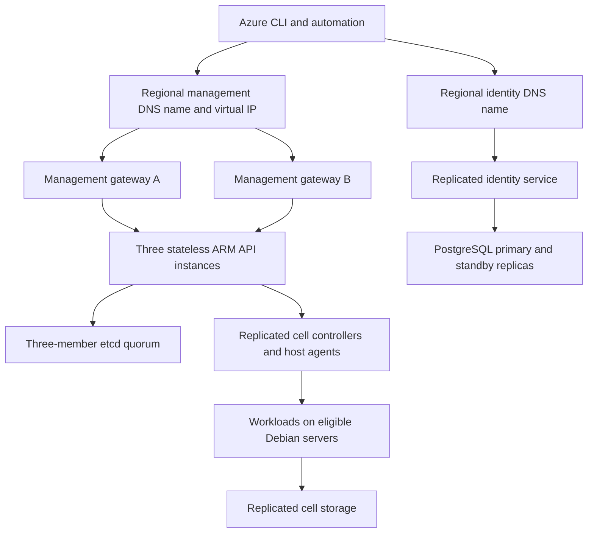

# ocean phase-one objective

Build an open-source cloud on Debian that provisions and operates tenant-isolated Linux containers and HTTP-triggered Azure Functions. Tenants can manage identities and access, build private networks, expose services over HTTPS, connect on-premises networks, and inspect their own resources, usage, quotas, and telemetry. Operators can add qualified hosts to a region and keep services running through individual host and gateway failures.

## Compatibility contract

Use the unmodified Azure CLI (`az`) as the reference client. Pin the CLI version and any required extensions. For each supported workflow, publish the tested commands, parameter combinations, resource types, and API versions. Cover Azure Resource Manager (ARM), the selected Microsoft Entra and Graph operations, and the selected monitoring and query APIs. Test resource IDs, status, pagination, authorization, errors, asynchronous completion, retries, and cleanup. An accepted create operation must converge to the requested resource or report a terminal failure. Reject unsupported parameters and operations explicitly.

Use `az cloud register` and `az cloud set` to select ocean. Verify user and service-principal login, subscription discovery, and token acquisition against that cloud. Bootstrap a customer tenant and its initial subscription through the ocean operator API, exercised with `az rest`. Expose tenant-scoped user, app, service-principal, and role-assignment operations through the selected `az ad` and `az role assignment` commands. Enforce tenant isolation and resource authorization in the API and the workload network.

## Phase-one capabilities

- **Linux container groups.** Pull public OCI images, set CPU and memory limits, inject ordinary and secret configuration, apply a restart policy, and support create, inspect, start, stop, restart, logs, and delete. Exercise both a public endpoint and private subnet placement. Provide a persistent file mount through the supported Azure Files contract. Verify data after restart and host recovery.
- **HTTP Functions.** Deploy a Linux Functions v4 image with a Java 21 HTTP trigger as the reference workload. Expose the selected `az functionapp` plan, lifecycle, image, settings, function discovery, and key operations. Verify the HTTP response with a valid function key, rejection with an invalid key, and a working update to a new image. Use public runtime base images and pin the deployed test fixtures by digest. Platform-generated test keys must be distinct from any example credentials bundled in a fixture.
- **Networking.** Provision private IPv4 VNets and subnets, security group rules, public IPs, HTTPS ingress, and NAT gateways. Connect private workloads to on-premises networks through redundant WireGuard gateways managed through the ocean API. Support VNet integration and stable source IP egress for Function Apps, including after gateway failover. Use the network-only Bicep workflow to exercise `az deployment group what-if` and `az deployment group create` for the selected network resource types.
- **Operations.** Expose tenant-scoped resource inventory, health, and an audit trail. Report instance and function metrics, container logs, request counts, error rates, latency percentiles, exceptions, and dependency telemetry. Expose measured resource consumption and quota usage. Enforce quotas during concurrent provisioning and distinguish reserved capacity from measured usage.

## Repository layout

Use a Go module at the repository root. Put the control-plane and node-agent entry points in `cmd/ocean-control-plane` and `cmd/ocean-agent`. Keep implementation packages in `internal/`, including the ARM API, identity, enrollment, reconciliation, node execution, networking, storage, federation, and observability. Add each package alongside the feature it implements.

Keep development topology profiles in `lab/profiles` and the black-box suite and workload fixtures in `tests/e2e`. The [E2E protocol](tests/e2e/protocol.md) specifies the fixture matrix, test runs, and evidence format.

## Proposed deployment topology

One ocean region consists of multiple Debian servers. Start with one workload cell and three designated control-plane servers. A server can host several roles. Additional servers join as compute, storage, or gateway capacity according to their qualification. Adding a workload server does not add another control-plane voter.

- Run one API replica and one etcd member on each of three designated servers in separate failure domains. The first installation stores ARM resource metadata, operation state, and cell reservations in separate key spaces of the same quorum. Two of the three members form a quorum. API instances serve requests concurrently and keep durable state in the quorum.
- Publish the management endpoint at one regional HTTPS name, such as `arm.region.ocean.example`. At least two gateways on different hosts serve the name and forward requests to healthy API instances. Use a failover virtual IP on a redundant LAN or an equivalent redundant routed frontend. The identity endpoint can use the same pair of gateways under a separate name. Production qualification includes DNS, load balancer, and upstream network reachability.
- Distribute identity service replicas and PostgreSQL instances across failure domains. PostgreSQL has one writable primary and standby replicas, with controlled promotion and fencing of the previous primary. The database and consensus services use private network paths. Start the management and storage control services independently of the tenant scheduler and guest storage.
- Place redundant replicas of a stateless workload on different hosts. Recover a single-writer workload on a permitted spare host after fencing. Reserve sufficient capacity to absorb a host failure at the declared load. Workload ingress, NAT, and VPN use redundant gateway roles, with their own reachability and failover tests.

### Availability and autoscaling

Choose a service availability tier per deployment. The tier sets the minimum placement and the failure the service must tolerate under its documented load and client policy.

| Service tier | Placement and continuity |
| --- | --- |
| Non-redundant | One active placement is sufficient. Persistent data follows its own storage protection policy. |
| Locally redundant | Maintain live placements on separate nodes in one farm and serve through loss of any one node. |
| Geo-redundant | Maintain live placements in independent authorized farms and serve through loss of any one farm. |

Use the same reconciler for replacement and autoscaling. Replacement restores the desired count and placement after a failure. Autoscaling adjusts the desired count within declared bounds using workload signals. Disabled autoscaling maintains a configured count. Local autoscaling adjusts capacity within the chosen farm or within each assigned farm. Geo autoscaling can allocate capacity across authorized farms. Preserve the availability tier's minimum placement while scaling in, and account for tenant quotas and reserved failover capacity when scaling out.

Offer fixed counts and local autoscaling in phase one. Qualify geo placement and geo autoscaling through the federation profile. Specify tier and scaling support per resource type and API version, including the mapping for any supported Azure provider parameters. Publish availability evidence for the complete service path, including ingress and data dependencies. Track storage replication and recovery objectives independently of the compute tier.

### Network paths

- **Management network.** Give ocean nodes private IPv4 addresses on a dedicated segment. Use mTLS for etcd peer traffic and node-agent connections to the control plane. The lab management gateways share this segment and transfer the virtual management IP when the active gateway fails. Give the CLI test client access to this segment so it can probe the same HTTPS endpoint before and after failover.
- **Workload network.** Carry Linux container, Functions, and guest VM traffic on a separate segment. Route tenant subnets through enforced isolation and firewall rules. Gateway interfaces connect the relevant networks and forward only permitted traffic.
- **On-premises network.** Connect a separate customer network through two WireGuard gateways. Route only the authorized tenant prefixes through the tunnels. Test reachability and routing failover from the customer side.

### DNS and service entry points

Publish node names from the provisioning inventory. Use redundant authoritative DNS for management, identity, service names, and discoverable federation endpoints. Regional names point to the regional virtual IP or an equivalent redundant frontend. Federation uses DNS to find approved peers and mTLS to authenticate them.

Geo-redundant services need a reachable ingress path through loss of a farm. Use health-checked endpoints and an ingress design that meets the client deadline with both fresh and cached DNS responses. Include connection recovery and configured DNS cache lifetimes in the observed service behavior. Distribute authoritative DNS and ingress across independent failure domains.

The geo HTTPS lab advertises stable addresses for two ingress edges outside the origin farms. Each edge uses HAProxy to verify origin TLS and readiness over the approved WireGuard routes. Both addresses continue to serve after loss of one origin farm.

### Geo-redundant farms

Connect participating sites through a WireGuard mesh of site gateways. Start with two gateways and independent uplinks per farm. Provide at least two independent tunnel paths between paired farms. Distribute only approved prefixes and monitor path health so routing can withdraw a failed path. BGP with BFD is a candidate for dynamic routing and failure detection.

Once a tunnel is reachable, pre-authorized farms discover each other's federation endpoint, authenticate with mTLS, and reconcile one durable pairing per farm pair. A retry or tunnel flap resumes the same pairing. Exchange permitted routing, health, capacity, and placement metadata according to the federation policy. Each farm runs its own control-plane, identity, and storage quorums and can continue local operations during a WAN partition.

Assign each federated resource an authoritative farm. Cross-site placement and replication require tenant authorization and an approved target. For a stateful failover, verify the replicated recovery point and fence the previous writer before enabling a replacement writer. Pause ownership transfers when coordination or effective fencing is unavailable.

Begin the geo simulation with four farms of three ocean nodes each. Add one node per farm through automated enrollment for the four-by-four acceptance run. Keep three control-plane voters per farm. Run the two WireGuard gateway roles on separate nodes in each farm. In the lab mesh, pair all four farms and provide two separate tunnel paths for each pair. A test client outside the farms probes service endpoints through the declared redundant access path. The geo profile also requires independent-site recovery evidence.

### Host provisioning and enrollment

Maintain a declarative inventory of approved hosts. Each record specifies the management interface MAC address, hostname, address reservation, provisioning profile, cell, operator pool, and eligible roles. The MAC address selects the network and provisioning profile. The host authenticates independently using a short-lived, single-use enrollment credential delivered through a trusted provisioning channel.

In the lab, generate the KVM guest configuration and a private cloud-init NoCloud seed from the inventory. At first boot, the agent generates a local key and proves possession during enrollment. Issue its individual mTLS certificate after successful enrollment. Commit credential redemption and the host record together. Recover an interrupted enrollment using proof of the same host key. Check capabilities and apply the approved role and pool policy before scheduling workloads. Keep control-plane voter membership separately configured.

### Zero-touch rack provisioning

Set up the rack provisioning network, out-of-band management network, and rack policies once. Import approved hardware identities and BMC access from a trusted purchasing or asset feed. Use that feed to populate the host inventory and derive the initial role and pool from the rack policy. The per-server workflow starts when an operator racks, cables, and powers on the machine.

1. Discover the machine through the provisioning or out-of-band network. Match its authenticated hardware or BMC identity to the approved asset. Record the boot NIC MAC address and allocate the management address and DNS name. Keep unidentified or mismatched machines in the provisioning network for investigation.
2. Use the site's bare-metal provisioning service to commission the machine and check hardware capabilities. Trigger a one-time network boot through Redfish where supported. Boot verified PXE or iPXE artifacts and install Debian and the ocean agent unattended according to the approved profile.
3. Deliver the enrollment credential through the authenticated installer or an out-of-band channel. After the agent joins and passes qualification, allow placement in its assigned cell and pool. Subsequent boots use the installed system. An explicit reinstallation action authorizes imaging an already enrolled host.

The production qualification includes a rack-to-ready run with a supported server and a preconfigured rack. The lab exercises the same inventory, join, and qualification flow using KVM and cloud-init.

## Reliability and trust

A region starts with one cell. Assign each workload and persistent volume to a cell. Hosts join using authenticated, individually revocable identities and are placed into operator pools only after qualification. Honor the tenant's pool selection during placement and recovery. Protect tenant data and snapshots at rest, control key access, and keep secrets out of logs and telemetry. Use approved operator pools for the first release and apply the tenant's security policy again on recovery.

Run redundant control-plane, identity, storage, and gateway roles. Maintain independent recovery paths for these dependencies. A loss of quorum must prevent new state-changing operations that require that quorum. Preserve existing workloads when their data paths remain available. Fence a previous volume writer before granting a replacement write access. Bound telemetry backlogs so telemetry failure cannot block provisioning or safety decisions. Verify backup and restore separately from replica failover.

Keep every service offered as locally redundant available through loss of one node in its farm. Keep every service offered as geo-redundant available through loss of one farm. Define the client request deadline and permitted retries before testing. During each fault, require every test operation to complete within that policy and record individual attempt failures, connection resets, and latency separately. Reserve enough capacity for the surviving placements. Use active replicas on separate hosts or farms for the HTTP continuity fixture. Qualify single-writer recovery against the declared recovery time, data-loss limits, and fencing policy.

Production claims require independent physical failure domains. Before a release run, record numerical limits for API and workload latency, supported load, failover and recovery time, acceptable data loss, and telemetry backlog. Use those limits for pass or fail decisions.

## Development lab on trixie

Run Debian ocean servers as small KVM guests. Start with three ocean nodes for the quorum and management-endpoint tests. Scale to 16 real ocean nodes for join, inventory, placement, drain, and recovery tests. The 16-node baseline allocates 1 GiB of RAM per node. Keep the three control-plane voters fixed while adding gateway and compute capacity. Limit concurrent workload instances so the run exercises scheduling and failure handling on the six-core development host.

Create separate user-space VDE switches for the management and workload segments. Attach each ocean guest to the switches it needs for its role. Give the simulated customer network and CLI test client distinct interfaces so the VPN and management failover tests exercise their intended paths.

| Starting profile | Guest RAM | vCPUs | Typical use |
| --- | ---: | ---: | --- |
| Small | 1 GiB | 1 | Baseline ocean node for the 16-node run |
| Workload | 2 GiB | 2 | Selected node running a Functions runtime or a nested test VM |
| Support service | 4 GiB | 2 | Initial trial for a database or another support role with a larger working set |

Configure RAM and vCPUs independently per node. Run both a uniform small-node test and a mixed-profile test sized to the resources available on `trixie`. Budget host and hypervisor overhead, disk capacity, and support services before starting a run. Record the role layout, configured memory and CPU, permitted CPU overcommit, and measured headroom. Increase or separately budget support nodes according to the selected backend's requirements. Run storage and identity failover with the real backends on suitably sized nodes.

Use small, representative fixtures. A public OCI HTTP image covers ordinary container lifecycle. A tiny stateful HTTP app writes a checksum to a mounted share and can generate controlled requests, errors, and dependency telemetry. A small Functions v4 Java 21 image exposes a keyed HTTP trigger. When the runtime uses nested virtualization, boot a mini Linux guest and verify KVM and network access from inside the ocean node. Use that guest to test the execution path in the lab.

## Additional compatibility profiles

A release can also include geo-redundant farm federation, Azure-compatible IPsec VPN commands, Functions ZIP deployment and slots, or monetary reporting through Cost Management. Each profile has its own acceptance gate. The phase-one release exercises on-premises WireGuard access, Functions deployed from OCI images, and measured usage and quotas.

Use [acceptance.tsv](acceptance.tsv) as the release checklist. A phase-one sign-off requires every required row to pass. Production sign-off also requires the production rows to pass. Each enabled compatibility profile requires its conditional rows to pass. Record the build, CLI and API versions, test environment, expected limits, measured results, and evidence for each run.
