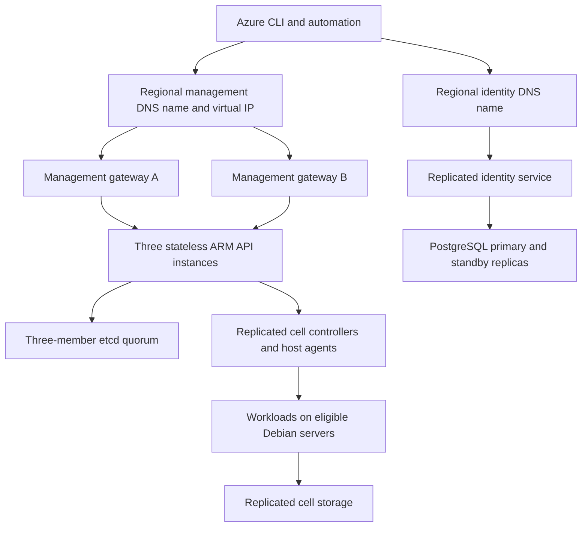

# ocean phase-one objective

Build an open-source cloud on Debian that provisions and operates tenant-isolated Linux containers and HTTP-triggered Azure Functions. Tenants can manage identities and access, build private networks, expose services over HTTPS, connect on-premises networks, and inspect their own resources, usage, quotas, and telemetry. Operators can add qualified hosts to a region and keep services running through individual host and gateway failures.

## Compatibility contract

Use the unmodified Azure CLI (`az`) as the reference client. Pin the CLI version and any required extensions. For each supported workflow, publish the tested commands, parameter combinations, resource types, and API versions. Cover Azure Resource Manager (ARM), the selected Microsoft Entra and Graph operations, and the selected monitoring and query APIs. Test resource IDs, status, pagination, authorization, errors, asynchronous completion, retries, and cleanup. An accepted create operation must converge to the requested resource or report a terminal failure. Reject unsupported parameters and operations explicitly.

Use `az cloud register` and `az cloud set` to select ocean. Verify user and service-principal login, subscription discovery, and token acquisition against that cloud. Bootstrap a customer tenant and its initial subscription through the ocean operator API, exercised with `az rest`. Expose tenant-scoped user, app, service-principal, and role-assignment operations through the selected `az ad` and `az role assignment` commands. Enforce tenant isolation and resource authorization in the API and the workload network.

## Phase-one capabilities

- **Linux container groups.** Pull public OCI images, set CPU and memory limits, inject ordinary and secret configuration, apply a restart policy, and support create, inspect, start, stop, restart, logs, and delete. Exercise both a public endpoint and private subnet placement. Provide a persistent file mount through the supported Azure Files contract. Verify data after restart and host recovery.
- **HTTP Functions.** Deploy a Linux Functions v4 image with a Java 21 HTTP trigger as the reference workload. Expose the selected `az functionapp` plan, lifecycle, image, settings, function discovery, and key operations. Verify the HTTP response with a valid function key, rejection with an invalid key, and a working update to a new image. Use public runtime base images and pin the deployed test fixtures by digest. Platform-generated test keys must be distinct from any example credentials bundled in a fixture.
- **Networking.** Provision private IPv4 VNets and subnets, security group rules, public IPs, HTTPS ingress, and NAT gateways. Connect private workloads to on-premises networks through redundant WireGuard gateways managed through the ocean API. Support VNet integration and stable source IP egress for Function Apps, including after gateway failover. Use the network-only Bicep workflow to exercise `az deployment group what-if` and `az deployment group create` for the selected network resource types.
- **Operations.** Expose tenant-scoped resource inventory, health, and an audit trail. Report instance and function metrics, container logs, request counts, error rates, latency percentiles, exceptions, and dependency telemetry. Expose measured resource consumption and quota usage. Enforce quotas during concurrent provisioning and distinguish reserved capacity from measured usage.

## Proposed deployment topology

One ocean region consists of multiple Debian servers. Start with one workload cell and three designated control-plane servers. A server can host several roles. Additional servers join as compute, storage, or gateway capacity according to their qualification. Adding a workload server does not add another control-plane voter.

- Run one API replica and one etcd member on each of three designated servers in separate failure domains. The first installation stores ARM resource metadata, operation state, and cell reservations in separate key spaces of the same quorum. Two of the three members form a quorum. API instances serve requests concurrently and keep durable state in the quorum.
- Publish the management endpoint at one regional HTTPS name, such as `arm.region.ocean.example`. At least two gateways on different hosts serve the name and forward requests to healthy API instances. Use a failover virtual IP on a redundant LAN or an equivalent redundant routed frontend. The identity endpoint can use the same pair of gateways under a separate name. Production qualification includes DNS, load balancer, and upstream network reachability.
- Distribute identity service replicas and PostgreSQL instances across failure domains. PostgreSQL has one writable primary and standby replicas, with controlled promotion and fencing of the previous primary. The database and consensus services use private network paths. Start the management and storage control services independently of the tenant scheduler and guest storage.
- Place redundant replicas of a stateless workload on different hosts. Recover a single-writer workload on a permitted spare host after fencing. Reserve sufficient capacity to absorb a host failure at the declared load. Workload ingress, NAT, and VPN use redundant gateway roles, with their own reachability and failover tests.

## Reliability and trust

A region starts with one cell. Assign each workload and persistent volume to a cell. Hosts join using authenticated, individually revocable identities and are placed into operator pools only after qualification. Honor the tenant's pool selection during placement and recovery. Protect tenant data and snapshots at rest, control key access, and keep secrets out of logs and telemetry. Use approved operator pools for the first release and apply the tenant's security policy again on recovery.

Run redundant control-plane, identity, storage, and gateway roles. Maintain independent recovery paths for these dependencies. A loss of quorum must prevent new state-changing operations that require that quorum. Preserve existing workloads when their data paths remain available. Fence a previous volume writer before granting a replacement write access. Bound telemetry backlogs so telemetry failure cannot block provisioning or safety decisions. Verify backup and restore separately from replica failover.

The three-node Debian lab on `trixie` exercises functionality and fault handling. Record the lab's capacity and verify nested KVM if the selected workload isolation needs it. Production claims require independent physical failure domains. Before a release run, record numerical limits for API and workload latency, supported load, failover and recovery time, acceptable data loss, and telemetry backlog. Use those limits for pass or fail decisions.

## Additional compatibility profiles

A release can also include Azure-compatible IPsec VPN commands, Functions ZIP deployment and slots, or monetary reporting through Cost Management. Each profile has its own acceptance gate. The phase-one release exercises WireGuard, Functions deployed from OCI images, and measured usage and quotas.

Use [acceptance.tsv](acceptance.tsv) as the release checklist. A phase-one sign-off requires every required row to pass. Production sign-off also requires the production rows to pass. Each enabled compatibility profile requires its conditional rows to pass. Record the build, CLI and API versions, test environment, expected limits, measured results, and evidence for each run.
